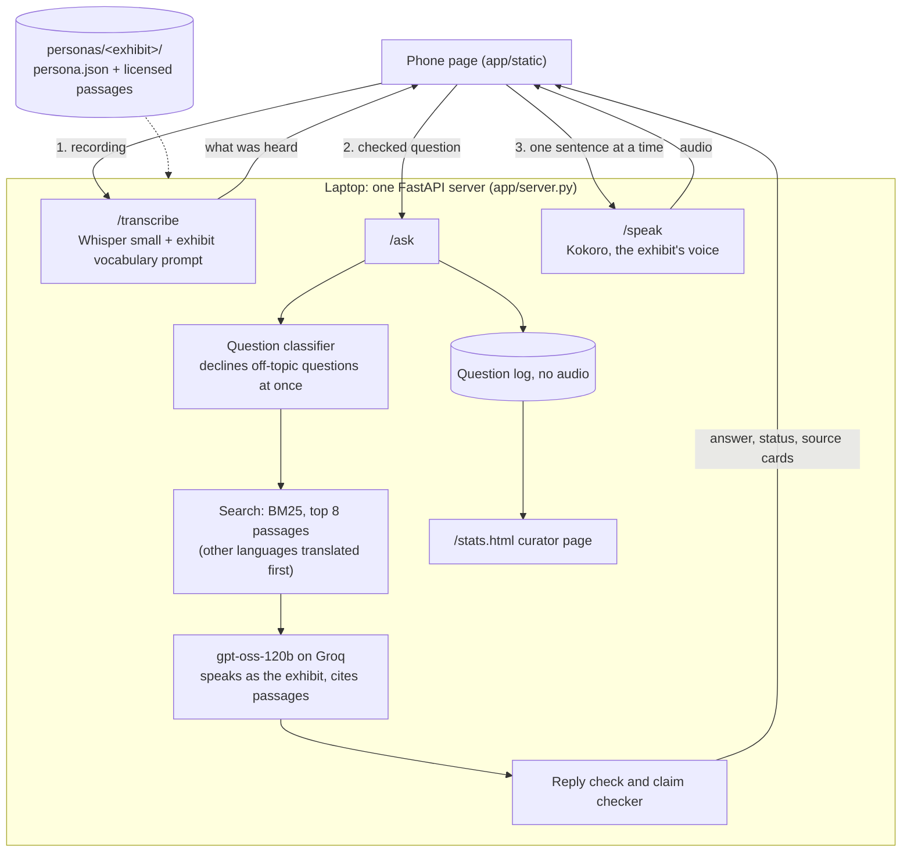

# Echoes.ai: final report

Outline, November 16 (#74). The finished report is 2 to 5 pages under these five headings. Each
section below lists what it will use. The final numbers come from one run in Session 12, on the
questions visitors wrote in Session 11 (#70, #72), with `openai/gpt-oss-120b`, the model in the
demo.

## Problem and users

- Visitors give a plaque a few seconds, and an audio guide plays the same recording for everyone
  and can't answer a question. Curators have to buy, charge and repair guide devices and record
  new tracks for every exhibit ([lean canvas](../../artifacts/lean_canvas.md), "Users and their
  problem").
- What exists: plaques, rented audio guides, human docents, and AI chatbots that are mostly text
  and don't publish how accurate they are (lean canvas, "What exists today").
- Who we tested with: 6 people from outside the team in Sessions 5, 7 and 8, and the phone test
  in Session 11 (#70, [user research plan](../../artifacts/user_research_plan.md)).

## Product

### What a visit looks like

A visitor walks up to an exhibit and scans the QR code beside it. A page opens on their own phone,
with nothing to install and no account. It opens on that exhibit, with its picture and colours at
the top and a greeting in its voice: "Hello, small mammal. I am Tyrannosaurus rex." (#15, #84).

They hold down the round talk button, ask their question out loud and let go. Before anything is
answered, the page shows what it heard in an "I heard" box. The visitor can fix a word, record
again or send it. If speech recognition was unsure, the box says so and asks them to check it.
We added this step after the Session 7 user tests, where 6 of 12 spoken questions were misheard
(#41). Visitors can also type instead.

The answer appears as text within about a second and is then spoken in the exhibit's own voice,
one sentence at a time. Each next sentence is made while the current one plays (#15). Under the
answer are source cards: which museum or encyclopedia each fact came from, its licence, and the
passage itself (#29). When the sources don't cover a question, the exhibit says so ("I have no
record of a childhood dog in my letters") instead of inventing an answer. A question about
something after its time, such as Van Gogh on Guernica, gets a polite refusal. An off-topic
question, such as the capital of France, is turned down at once without calling the language
model (#52). The T. rex can also roar on request: it says a short line, then plays the sound.

Questions can be asked in Hindi, Marathi, Kannada and Spanish, and the answer comes back in the
same language (#50, #63). Hindi and Spanish also work by voice, both asked and spoken back (#71).
Marathi and Kannada answers are shown as text only, because Kokoro has no voice for them. Visitors' audio is turned
into text and never saved.

A curator opens "Curator stats" from the footer. It shows how many questions each exhibit got,
what visitors ask about grouped by topic, and which questions the sources could not answer. That
last list shows where a museum could add sources (#53, #61).

### How the parts fit together

The phone page talks to one FastAPI server through four requests. `/transcribe` turns the
recording into text with Whisper. The `small` model gets a vocabulary prompt built from the
exhibit's own names, such as Theo, Arles or Maastrichtian, so it spells them right (#41).

`/ask` does the answering. The question classifier first catches questions the exhibit should not
answer, such as off-topic ones or ones that name a year after the exhibit's time (#52).
Otherwise a BM25 search picks the 8 passages most likely to hold the answer from that exhibit's
sources. Questions in other languages are translated for the search. gpt-oss-120b then answers in
character from those passages and names the ones it used. It also gives the reply a status:
answered, not in the sources, outside its time, or declined. The reply check makes sure what the
visitor sees is backed by the passages. An "answered" reply with no valid citation becomes "not
in my sources". A reply that can't be read, or a decline that answers anyway, is replaced with a
fixed line (#28, #62). The claim checker logs any detail the
passages do not back (#40, #60). The answer comes back with its source cards.

The page then calls `/speak` for each sentence, and Kokoro reads it in the exhibit's voice, or in
a Hindi or Spanish voice when the visitor asked in that language. Every question is logged
without audio, and `/stats` builds the curator page from that log.

Both exhibits run on the same code. Everything that makes Van Gogh different from the T. rex
lives in `personas/<exhibit>/`: `persona.json` (name, time period, speaking style, voice,
greeting and sounds) and the licensed passages it may cite. Adding an exhibit means adding a
folder, not changing code.

It runs on a laptop. A free Cloudflare tunnel gives phones a temporary https link, and
`scripts/generate_qr.py` turns that link into the QR codes. There is no permanent link because
we could not host Whisper and Kokoro for free (#51, section 4.6 of
[`artifacts/architecture.md`](../../artifacts/architecture.md)). The older picture in
`artifacts/images/system_architecture.png` is from the September design. It still shows a
Hugging Face Space and audio streamed in one request, so the diagram above replaces it.

In a rehearsal on November 23, with nothing else running, each step took about this long:

| Step | Time |
|---|---|
| Transcript | 2.6 to 3.0 s |
| Answer text | 0.5 to 1.4 s |
| First spoken sentence | 0.4 to 0.6 s more |

Asking questions back to back hits Groq's free-tier limit per minute, and answers then took 10 to
21 s ([demo script](../../artifacts/demo_script.md)).

## NLP method and evaluation

- The pipeline, and what each part was measured on:
  - speech to text: Whisper small with a prompt for each exhibit, word error rate 0.053 on 40
    clips from 5 speakers ([results](../../eval/results/stt_results.md), #41)
  - search: BM25 with query normalization, and hybrid search with embeddings as an option
    ([comparison](../../eval/results/retrieval_comparison.md), #31, #39)
  - answers: gpt-oss-120b speaking as the exhibit and citing passages (#14)
  - checks: the reply check (#28, #62), the claim checker in `/ask`
    ([results](../../eval/results/claims_results.md), #40, #60), the quote checker
    ([results](../../eval/results/quotes_results.md), #42), the time check with Wikidata dates
    ([results](../../eval/results/timecheck_results.md), #43) and the question classifier
    ([results](../../eval/results/classifier_results.md), #52)
  - topic tags on the curator page ([results](../../eval/results/topics_results.md), #61), and
    translation of other languages for search (#50)
- The north star across sessions: 59 of 64 in Sessions 7 and 10 on gpt-oss-120b, and 55 in
  Session 8 on llama3 ([comparison](../../eval/results/north_star_comparison.md)), rescored with
  the fairer key-fact check (#72), and the final number on the visitor-written questions.
- Persona against a plain museum guide on the same passages: a paired McNemar test with a
  Newcombe interval (last run on the Session 5 answers: -2.3 points, p = 1.00,
  [results](../../eval/results/compare_modes.md), #30; rerun on the current code in #73).
- Robustness: 20 adversarial prompts, 16 held and then 19 after the reply check fix
  ([results](../../eval/results/robustness_results.md), #54, #62).
- Other languages: the language of 12 of 12 questions per exhibit was detected correctly, and in
  Session 9 all 9 Van Gogh questions were answered in the visitor's language (#50). The committed
  T. rex replies come from the offline stand-in, not the model, so the T. rex result needs a rerun
  on gpt-oss-120b before it goes in ([results](../../eval/results/multilingual_results.md), #63).
- Course topics this touches: hypothesis testing, evaluation, embeddings, classifiers, retrieval
  augmented generation, knowledge graphs (Wikidata) and bias and ethics.
- What did not work, with numbers. Candidates: the topic rules miss words that are not on their
  lists (0 of 2 on death and extinction, #61), the year rule catches only after-time questions
  that name a year (0 of 16 on the time check set, #52), the claim checker logs unbacked details
  but does not block them (#60), and the quote checker is not in `/ask` (#42).

## User evidence

- Session 5: 1 person ([evidence](../../artifacts/evidence/session05/)).
- Session 7: 3 people. 10 of 15 tasks completed, 6 of 12 spoken questions misheard, and ratings
  of 3.5, 3 and 4 out of 5 for using it in a museum ([evidence](../../artifacts/evidence/session07/)).
- Session 8: 2 people ([evidence](../../artifacts/evidence/session08/)).
- Session 11: 3 people on their own phones (#70).
- What we changed because of them: the transcript box and the exhibit prompts after people were
  misheard (#41), and what Session 11 leads to.
- What the 30 logged visitor questions were about, from the curator page (#61).

## Ethics and limitations

- Data and licences: CC0, CC BY-SA, CC BY 4.0 and public domain, with the credit kept on every
  passage ([data sources](../../artifacts/data_sources.md)).
- Privacy: audio is never saved, the request logs stay out of the repo, and the evidence is
  anonymized.
- Honesty: it says it is an AI when asked (#62), and the voice is made up, not a clone of anyone.
- Bias: speech recognition by speaker (#41), and voice in English only (#71).
- Limits: two exhibits, one model on a free tier with daily token limits, a laptop and a tunnel
  instead of hosting, small user tests, and test sets for some checks written by the same person
  who wrote the rules (#52, #61).
- Something that did not work, named plainly, from the candidates above.
